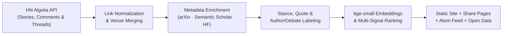

<div align="center">

# HackerPapers

**The AI research papers Hacker News keeps recommending—and what engineers & researchers actually said about them.**

[](https://agilealpha1.github.io/HackerPapers/)
[](https://github.com/agilealpha1/HackerPapers/actions/workflows/pages.yml)
[](https://www.youtube.com/watch?v=C4qyRfgRFvA)
[](https://opendatacommons.org/licenses/by/1-0/)

[**Explore the Site**](https://agilealpha1.github.io/HackerPapers/#top) · [**Reading Paths**](https://agilealpha1.github.io/HackerPapers/#paths) · [**Topics**](https://agilealpha1.github.io/HackerPapers/#topics) · [**Ask the Papers**](https://agilealpha1.github.io/HackerPapers/#ask) · [**Atom Feed**](https://agilealpha1.github.io/HackerPapers/feed.xml)

</div>

---

## Why HackerPapers?

Citation counts tell you what academia cites; social feeds tell you what went viral this morning. **HackerPapers** mines nearly two decades of Hacker News discussions to surface the AI and machine learning papers practitioners keep coming back to—complete with verbatim pull-quotes, author Q&As, technical pushback, code repositories, and video walkthroughs.

| Metric | Coverage |
| :--- | :--- |
| **Papers indexed** | **537** community-vetted AI papers (+ **50** curated reading-path papers) |
| **HN discussions analyzed** | **51,288** stories & comments from **14,681** distinct HN contributors |
| **Taxonomy & tracks** | **46** topics across **8** research areas · **9** chronological reading paths |
| **Enrichment** | Semantic Scholar citations · Hugging Face models/datasets/code · `bge-small` embeddings |
| **Architecture** | **100% static** HTML + sharded JSON · Zero accounts, zero cookies, zero tracking |

---

## Key Features

### 1. Eight Signal-Driven Feeds

| Feed | What It Surfaces |
| :--- | :--- |
| [**Top papers**](https://agilealpha1.github.io/HackerPapers/#top) | Ranked by distinct HN recommenders, recurrence across months, post points, citations, and recency |
| [**All-time classics**](https://agilealpha1.github.io/HackerPapers/#classics) | Foundational papers (3+ years old) that HN continues recommending month after month |
| [**Trending this year**](https://agilealpha1.github.io/HackerPapers/#trending) | Papers gaining sustained HN recommendations over the past 12 months |
| [**Has code**](https://agilealpha1.github.io/HackerPapers/#code) | Papers paired with verified GitHub/GitLab repositories (from the paper, the author, Hugging Face, or HN) |
| [**Beginner-friendly**](https://agilealpha1.github.io/HackerPapers/#beginner) | Surveys, tutorials, and papers HN readers consistently call clear and accessible |
| [**Lasting favorites**](https://agilealpha1.github.io/HackerPapers/#lasting) | Recommended across 4+ distinct months spanning 3+ years—the opposite of a one-week hype cycle |
| [**From the authors**](https://agilealpha1.github.io/HackerPapers/#authors) | Papers where the authors showed up on HN to explain trade-offs, share context, or answer questions |
| [**Most debated**](https://agilealpha1.github.io/HackerPapers/#debated) | Papers with strong praise *and* substantive methodological or practical pushback |

### 2. Deep Paper Dossiers
Every paper opens a dedicated reading-room page with:
- **Why HN recommends it:** Verbatim community quotes linked directly to the original HN comment.
- **The Author on HN:** Highlighted comments written by the paper's own authors in the discussion threads.
- **The Debate (*For* vs. *Against*):** Recommendations placed side-by-side with technical criticism and skepticism.
- **HN Over Time:** Yearly mention/recommendation/pushback chart, *Lasting* vs. *Spike* badges, and *"Then vs. Later"* comment snapshots years apart.
- **Code, Citations & Ecosystem:** Direct **Video** walkthroughs, **PDF** & arXiv/venue links, Semantic Scholar citation velocity, Hugging Face models/datasets/Spaces, *"Read first"* prerequisites, and related papers.

### 3. Reading Paths, Semantic Search & Local Personalization
- **[Reading Paths](https://agilealpha1.github.io/HackerPapers/#paths):** Guided tracks ordered oldest-to-newest (*Transformers from zero*, *Scaling laws and emergence*, *LLM agents*, *Fine-tuning, RLHF and alignment*, *Looking inside the model*, *Generative images and audio*, *Making models small and fast*, *Reinforcement learning and games*, plus multi-stage curated paths).
- **[Ask the Papers](https://agilealpha1.github.io/HackerPapers/#ask) & Hybrid Search:** Combines instant keyword matching, full-abstract word indexing, and in-browser `int8` quantized `BAAI/bge-small-en-v1.5` vector similarity.
- **[For You](https://agilealpha1.github.io/HackerPapers/#foryou) & Reading List:** Follow topics, save papers, and mark papers as read. Export or move your list anytime as **Markdown**, **BibTeX**, or **JSON**.

---

## Video Walkthroughs

We are turning the highest-signal papers on HackerPapers into concise visual breakdowns on YouTube. Papers with a published episode display a **`Video`** button right beside **`PDF`** on every feed card and paper page.

- **Episode #1:** [*Attention Is All You Need* (Vaswani et al., 2017)](https://www.youtube.com/watch?v=C4qyRfgRFvA) · [View on HackerPapers](https://agilealpha1.github.io/HackerPapers/#paper-arxiv-1706-03762)

---

## Keyboard Shortcuts

Press `?` anywhere on the site to view shortcuts:

| Key | Action |
| :--- | :--- |
| `j` / `k` | Move to next / previous paper |
| `Enter` | Open the selected paper page |
| `o` | Open the paper's PDF in a new tab |
| `s` / `r` | Save to Reading List / Mark as read |
| `/` | Focus the search bar |
| `g` then `h` `f` `l` `t` `p` `a` | Jump to **H**ome, **F**or You, Reading **L**ist, **T**opics, **P**aths, or **A**sk |
| `Esc` | Return from a paper page to the list |

---

## How the Pipeline Works



1. **Collection & Normalization:** Links to `arxiv.org`, `ar5iv.org`, `openreview.net`, `aclanthology.org`, `neurips.cc`, and `proceedings.mlr.press` are extracted and canonicalized to a single paper ID (merging conference copies with their arXiv preprints via title and Semantic Scholar IDs).
2. **Stance & Self-Promo Filtering:** Mentions are classified into `strong_rec`, `rec`, `reference`, `critical`, or `author` (using Claude labels with rule + sentiment fallbacks). **Author self-promotion never counts as a recommendation.**
3. **Qualification Bar:** A paper must belong to core AI/ML categories (`cs.AI`, `cs.LG`, `cs.CL`, `cs.CV`, `cs.NE`, `cs.MA`, `stat.ML`, or ML conferences) and earn recommendations from **at least 2 distinct HN users**.
4. **Ranking:** Combines log-scaled distinct recommenders, total discussants, distinct recommendation months, top HN story points, strong recommendations, and Semantic Scholar citations, minus criticism, with a smooth recency boost. *A high score reflects Hacker News community discussion—not a guarantee of scientific validity.*

---

## Local Development

```bash
# 1. Install Python dependencies (optional ML libs have pure-Python fallbacks in pipeline/fallbacks.py)
python3 -m pip install -r requirements.txt

# 2. Run the test suites
python3 pipeline/test_normalize.py
python3 -m unittest discover -s pipeline/tests -v

# 3. Build site data, open-data bundle, and static deploy directory
python3 pipeline/build_site_data.py
python3 pipeline/export_open_data.py
HP_BASE_URL="http://localhost:8000/" python3 pipeline/make_static.py --out site_dist

# 4. Serve locally
python3 -m http.server 8000 --directory site_dist
```

- **Add a YouTube walkthrough:** Map `"arxiv:<id>": "https://www.youtube.com/watch?v=..."` in [`data/paper_videos.json`](data/paper_videos.json) and rebuild.
- **Curate a new reading path:** Run `python3 pipeline/make_path.py --topic "..." --seeds ... --keywords "..."`.
- **Weekly data refresh:** See [`deploy/weekly_update.sh`](deploy/weekly_update.sh).

---

## Privacy, Data Sources & License

- **Privacy:** No accounts, analytics scripts, or server databases. Your saved papers, read history, and *For You* topic preferences stay strictly in your browser's `localStorage`.
- **Data Sources:** Discussion data via the [HN Algolia API](https://hn.algolia.com/api); paper metadata from [arXiv](https://arxiv.org/); citation counts from [Semantic Scholar](https://www.semanticscholar.org/); model/dataset/code links from [Hugging Face](https://huggingface.co/); conference talk links via [HackerTube](https://hackertube.org/).
- **License & Disclaimer:** Exported dataset metadata is made available under [ODC-By 1.0](https://opendatacommons.org/licenses/by/1-0/) (HN comments remain the work of their respective authors; arXiv metadata is subject to arXiv's terms). HackerPapers is an independent project and is not affiliated with Hacker News, Y Combinator, arXiv, or the other services listed above.
